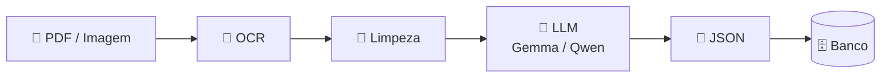

<p align="center">
  
</p>

<p align="center">
  
</p>

<p align="center">
  
  
  
</p>

## 👾 Player 1

```text
┌────────────────────────────────────────────┐
│  NOME ............ José Mateus             │
│  CLASSE .......... Dev Jr em IA            │
│  GUILDA .......... OrigoX                  │
│  ESCOLA .......... Ciência da Computação   │
│                    IFG · 8º semestre       │
│  PRÓXIMA FORMA ... AI Engineer             │
│  ARMA PRINCIPAL .. Python + IA             │
└────────────────────────────────────────────┘
```

Sou Desenvolvedor Jr em IA, evoluindo para **AI Engineer**. Jogo na fase entre Engenharia de Software e Inteligência Artificial: modelos que apoiam decisões no mercado de futuros e pipelines de NLP e LLMs que transformam texto bagunçado em dados estruturados.

## ⚔️ Quests

<table>
<tr>
<td width="50%" valign="top">

### 📈 OrigoX - Desenvolvedor Jr
**🟢 Quest ativa** · set/2026 - Até hoje

IA para automação e suporte a operações no mercado de futuros.

- Engenharia de dados financeiros
- Modelagem preditiva e decisória
- Automação de rotinas de execução e análise
- Pipelines em tempo real e integração de sistemas

</td>
<td width="50%" valign="top">

### 🎓 Projeto Aurora - Pesquisador em IA
**✅ Quest concluída** · nov/2025 – nov/2026

Extração inteligente de dados de diplomas e certificados.

- LLMs open-source (Gemma / Qwen)
- Prompt engineering avançado
- OCR para PDFs não estruturados
- Dados padronizados para processos universitários

</td>
</tr>
</table>

<details>
<summary><b>🗺️ Mapa da quest Aurora</b></summary>
<br>



</details>

## 🎒 Inventário

<p align="center">
  
</p>

<p align="center">
  
  
  
  
</p>

## 📊 Atributos

```text
PYTHON / ENG. SOFTWARE   ■■■■■■■■■□  LV 9
LLMs & PROMPTS           ■■■■■■■■□□  LV 8
NLP & EXTRAÇÃO           ■■■■■■■■□□  LV 8
PYTORCH / FINE-TUNING    ■■■■■■■□□□  LV 7
IA PARA EXTRAÇÃO         ■■■■■■■□□□  LV 7
DOCKER & SERVIÇOS        ■■■■■■■□□□  LV 7
```

## 🐍 Snake

<p align="center">
  <picture>
    <source media="(prefers-color-scheme: dark)" srcset="https://raw.githubusercontent.com/josemateusferreira/josemateusferreira/output/github-snake-dark.svg" />
    <source media="(prefers-color-scheme: light)" srcset="https://raw.githubusercontent.com/josemateusferreira/josemateusferreira/output/github-snake.svg" />
    
  </picture>
</p>

<p align="center">
  
</p>

## 💾 Save Point

<p align="center">
  <a href="mailto:josemateus17@outlook.com"></a>
  <a href="https://linkedin.com/in/josemateusferreira"></a>
</p>

<p align="center">
  
</p>
