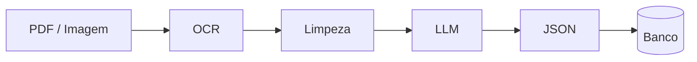

<p align="center">
  
</p>

<p align="center">
  
</p>

<p align="center">
  
  
  
  
</p>

## $ whoami

```text
nome       José Mateus
cargo      Dev Jr em IA @ OrigoX
formação   Ciência da Computação · IFG (8º semestre)
objetivo   me tornar AI Engineer
interesses IA aplicada, dados e automação
```

Trabalho entre engenharia de software e inteligência artificial e sigo estudando para dar o próximo passo.

## $ ls ./experiencia

| Onde | Papel | Período | Status |
| --- | --- | --- | --- |
| OrigoX | Desenvolvedor Jr | set/2026 – hoje | ● em andamento |
| Projeto Aurora | Pesquisador em IA | nov/2025 – nov/2026 | ✓ concluído |

<details>
<summary><b>OrigoX — o que eu faço</b></summary>
<br>

- IA aplicada ao mercado de futuros
- Dados, automação e integração de sistemas

</details>

<details>
<summary><b>Projeto Aurora — o que eu fiz</b></summary>
<br>

- Extração de dados de diplomas e certificados
- OCR e LLMs open-source
- Saída estruturada em JSON



</details>

## $ cat stack.txt

<p>
  
  
  
  
  
  
  
  
</p>

## $ top --skills

```text
Python / Eng. Software   █████████░  9
LLMs & Prompts           ████████░░  8
NLP & Extração           ████████░░  8
PyTorch / Fine-tuning    ███████░░░  7
Docker & Serviços        ███████░░░  7
```

<sub>autoavaliação, sempre em evolução</sub>

<p align="center">
  <picture>
    <source media="(prefers-color-scheme: dark)" srcset="https://raw.githubusercontent.com/josemateusferreira/josemateusferreira/output/github-snake-dark.svg" />
    <source media="(prefers-color-scheme: light)" srcset="https://raw.githubusercontent.com/josemateusferreira/josemateusferreira/output/github-snake.svg" />
    
  </picture>
</p>

## $ contato

<p>
  <a href="mailto:josemateus17@outlook.com"></a>
  <a href="https://linkedin.com/in/josemateusferreira"></a>
</p>

<p align="center">
  
</p>
